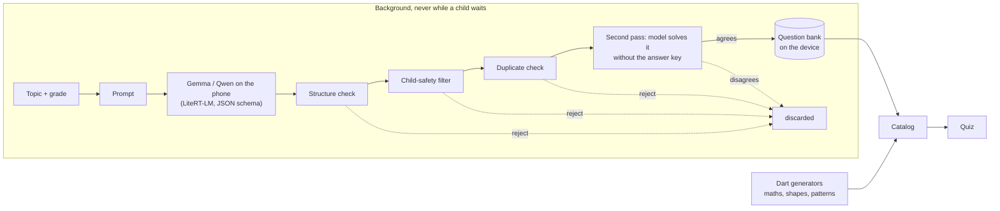

<div align="center">

# Wonderly

**A playful learning app for children in grades 1 to 5, powered by an AI that runs entirely on the phone.**

No backend. No account. No ads. No tracking.

[](https://github.com/jihanurrahman33/Wonderly/actions/workflows/ci.yml)


</div>

---

## What it is

Wonderly asks one question per screen and rewards every right answer with stars, streaks and badges. A grown-up
installs a small language model **once** and from then on the phone writes fresh quizzes for the child's grade, and
a weekly note for the parent. Everything the child sees is produced and checked on the device.

| For children | For grown-ups |
|---|---|
| Six subjects: Zoology, Geometry, Plants, Logic, Numbers, Words | Parent gate that a young child cannot pass |
| Four question types, hints and read-aloud | Daily play limit that really ends a session, bedtime mode |
| Stars, day streaks, six badges, sound and music | Weekly note and progress, per child |
| A friendly **Smart Buddy** card with the next quiz to play | Smart Buddy setup: model choice, download, storage |
| Several children can share one phone | Everything stays on the device |

## On-device AI, done carefully

Small language models are good at wording and unreliable at facts and structure, so Wonderly never trusts one
blindly. The model is used where it adds value, and **every output passes code before a child sees it**.



| Content | Written by | Why |
|---|---|---|
| Zoology (4 sets), Plants, Words | **On-device language model** | Open-ended facts and wording |
| Numbers, Geometry, Logic | **Dart generators** | Answers are exactly computable, so they can never be wrong. Difficulty follows the learner's grade |
| Safety net | A small bundled bank | Used only until the model has written enough (first run, no model, unsupported phone) |

Generated questions are saved immediately, so cancelling or closing the app loses nothing. Each time a child finishes a
set, the next play uses a fresh window of the bank. Generation pauses while a quiz is open, when the app is in the
background, and when the battery is low.

### Generative UI with A2UI

The Smart Buddy card is drawn from [A2UI](https://a2ui.org) messages using the
[`genui`](https://pub.dev/packages/genui) renderer. The on-device model plays the agent: it writes the card and picks
the next quiz. Its reply is **validated, reduced to plain values, then re-emitted as A2UI** by the app, so nothing
unchecked reaches the renderer. The catalog is deliberately tiny (cards, text, layout, a stat tile and an action
button): there is no image, video, link or text-input component, so a model cannot show remote content or collect
anything from a child. If the model is missing, slow or wrong, a built-in message takes its place.

```
child opens Home ─▶ BuddyAgent ─▶ on-device model ─▶ A2uiValidator ─▶ A2UI messages
                          │                                                  │
                          └── model unavailable / invalid ─▶ built-in text ──┤
                                                                             ▼
                                      A2uiTransportAdapter ─▶ SurfaceController ─▶ Surface (widgets)
                                                                             │
                                         startQuiz action ◀─ ActionButton ◀──┘
```

### Models

Two open-licence (Apache 2.0) LiteRT-LM builds, downloaded once from Hugging Face with no account or token:

| Profile | Model | Download | Needs |
|---|---|---|---|
| Balanced (default) | Qwen 2.5 1.5B Instruct | 1.6 GB | about 4 GB RAM |
| Best quality | Gemma 4 E2B | 2.6 GB | about 6 GB RAM |

A grown-up chooses and downloads the model in **Grown-ups zone → Smart Buddy**, behind the parent gate. The app warns
before using mobile data, shows progress, allows cancelling, and can remove the model to free the space.

## Getting started

Requirements: Flutter 3.47+ (Dart 3.13), Android Studio or Xcode. On-device AI needs **Android 11+ on a 64-bit ARM
phone** or **iOS 15+**; on anything else the app still works with its built-in questions.

```bash
git clone https://github.com/jihanurrahman33/Wonderly.git
cd Wonderly
flutter pub get
flutter run            # pick an Android or iOS device
```

First run on a phone: finish the welcome tour, create a learner, then open **Me → Grown-ups zone**, solve the maths
question, choose **Smart Buddy** and download a model on Wi-Fi.

### Quality gates

CI runs these on every pull request:

```bash
dart format --output=none --set-exit-if-changed lib test
flutter analyze --fatal-infos
flutter test --coverage && tool/check_coverage.sh 80
flutter build apk --debug
```

## Architecture

Clean Architecture with a feature-first layout and BLoC. Dependencies point inward; `domain` is plain Dart.

```
lib/
  core/        theme, router, DI, storage, services (speech, sound, haptics), shared widgets
  features/
    ai/          LlmClient, model manager, question generator, bank filler, A2UI agent and catalog
    learning/    curriculum, procedural generators, catalog assembly, subjects and quiz sets
    quiz/        QuizBloc, four question views, results
    progress/    stars, streaks, badges, rewards, weekly stats
    profile/     learners (several per phone), setup form
    parent/      parent gate, grown-ups dashboard
    settings/    preferences, play limit and bedtime rules
    home/ onboarding/
assets/        svg/ audio/ icon/ fonts/ data/ (safety-net questions)
docs/          architecture, ADRs, design mapping, content, release, roadmap
test/          221 unit and widget tests
tool/          audio and icon generators, coverage gate
```

| Concern | Choice |
|---|---|
| State | `flutter_bloc` (Bloc and Cubit), `bloc_concurrency` |
| Navigation | `go_router` with a stateful tab shell and a parent-gate redirect |
| DI | `get_it`, composition root only |
| On-device LLM | `flutter_edge_ai` + `flutter_edge_ai_litertlm` |
| Generative UI | `genui` (A2UI) |
| Storage | `shared_preferences` behind versioned JSON repositories |
| Audio | `audioplayers` with synthesised sounds (`tool/generate_audio.py`) |
| Device | `device_info_plus`, `connectivity_plus`, `battery_plus` |
| Errors | sealed `Result` and `Failure`, global error zone, friendly UI messages |

Read [docs/ARCHITECTURE.md](docs/ARCHITECTURE.md) for data flow and rules, and the [ADRs](docs/adr/README.md) for why.

## Privacy and child safety

- No accounts, analytics, advertising or crash SDKs. Names, answers and progress never leave the phone.
- The **only** network use is the one-time, grown-up-approved model download. Questions are written on the device.
- The grown-ups zone sits behind a maths gate with a lockout. Bedtime changes need it too.
- Every model-written word passes a child-safety filter and a structural validator before it can be shown.
- No outbound links or purchases anywhere a child can reach.

## Testing

221 tests, 91% line coverage. They cover the generators (every arithmetic answer is recomputed and every pattern is
re-derived), the validation pipeline with a scripted fake model, the A2UI path through the real renderer, the parent
gate, play limits, multiple learners, storage failure and corruption, and layout on a 320 x 568 phone at the largest
text size. A fake model and fake platform services keep the suite hermetic.

What automated tests cannot prove: the real model's speed, memory and quality on your phones. See
[docs/RELEASE.md](docs/RELEASE.md) for the device checklist.

## Documentation

| | |
|---|---|
| [Architecture](docs/ARCHITECTURE.md) | Layers, data flow, AI pipeline, error handling |
| [Design mapping](docs/DESIGN_MAPPING.md) | Every design screen mapped to code, with deviations |
| [Content](docs/CONTENT.md) | How questions are produced and how to extend the curriculum |
| [Release](docs/RELEASE.md) | Signing, store policy, device checklist |
| [Roadmap](docs/ROADMAP.md) | What is next |
| [ADRs](docs/adr/README.md) | Decision records |
| [Contributing](CONTRIBUTING.md) · [Security](SECURITY.md) · [Changelog](CHANGELOG.md) | |

## License

Not yet chosen. Until a license file is added, all rights are reserved by the author. The Fredoka and Nunito fonts are
licensed under the SIL Open Font License 1.1; the on-device models carry their own Apache 2.0 licenses.
